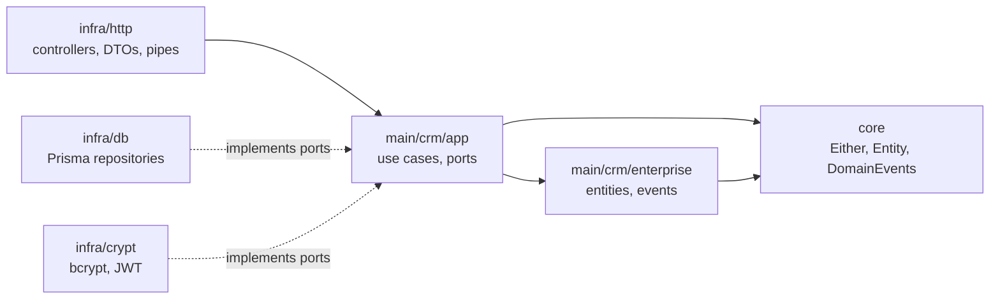

<div align="center">
  
  
  
  
  
  
  
  
  
</div>

# Sales CRM API

A REST API for a **Sales Analytics CRM** built with **NestJS**, **Prisma/PostgreSQL**, **Domain-Driven Design (DDD)** and **Clean Architecture**.

Salespersons manage their **clients** and **sales opportunities**, while **managers** administer the sales team and get notified about high-value deals. The business rules live in a framework-agnostic domain/application core; NestJS, Prisma, JWT and bcrypt are plugged in as infrastructure adapters.

## Table of Contents

- [Features](#features)
- [Business Rules](#business-rules)
- [Implementation Status](#implementation-status)
- [Tech Stack](#tech-stack)
- [Getting Started](#getting-started)
- [Environment Variables](#environment-variables)
- [Scripts](#scripts)
- [API Overview](#api-overview)
- [Project Structure](#project-structure)
- [Architecture](#architecture)
- [Testing](#testing)
- [Documentation](#documentation)
- [Roadmap](#roadmap)

## Features

- Two user roles: **Salesperson** and **Sales Manager**.
- E-mail and password authentication, returning a JWT access token.
- Salesperson management (manager-only): register, list, get by ID, update, change password and inactivate (soft delete).
- Client registration, owned by the logged-in salesperson.
- Domain events for sales opportunities (created, status changed, high value, lost, delivered) with manager notifications.
- Request validation with Zod and interactive API docs with Swagger.

## Business Rules

- Only **managers** can manage salespersons (register, list, read, update, change password, inactivate).
- Only the **logged-in salesperson** can manage their own clients.
- Every client has an associated salesperson; the **first one is the salesperson who created it**.
- Every sales opportunity belongs to a **client** and a **salesperson**; its creator is its first owner.
- Marking an opportunity as **delivered** requires a photo, and is only possible from the `won` status.
- An opportunity can only be marked as **lost** while `open` or `in_progress`.
- A salesperson **cannot list another salesperson's** sales.
- Inactive salespersons **cannot authenticate**.
- The manager is notified when a sales opportunity reaches a **high value (>= 10,000)**.

## Implementation Status

The domain and application layers are complete and unit-tested. The HTTP layer is being exposed incrementally.

| Area                 | Domain + use cases | HTTP endpoint |
| -------------------- | :----------------: | :-----------: |
| Authentication       | Done               | Done          |
| Salespersons         | Done               | Done          |
| Clients              | Done               | Register only |
| Sales opportunities  | Done               | Pending       |

## Tech Stack

| Concern         | Tool                                                              |
| --------------- | ----------------------------------------------------------------- |
| Framework       | [NestJS 11](https://nestjs.com/)                                  |
| Language        | [TypeScript](https://www.typescriptlang.org/) (strict)            |
| Database        | [PostgreSQL 17](https://www.postgresql.org/)                      |
| ORM             | [Prisma 6](https://www.prisma.io/)                                |
| Auth            | JWT (`@nestjs/jwt`, `passport-jwt`) + `bcryptjs`                  |
| Validation      | [Zod](https://zod.dev/)                                           |
| API docs        | Swagger (`@nestjs/swagger`)                                       |
| Tests           | [Vitest](https://vitest.dev/) + Supertest + SWC                   |
| Tooling         | ESLint, Prettier, pnpm, Docker                                    |

## Getting Started

### Prerequisites

- Node.js `24` (see `.nvmrc`)
- [pnpm](https://pnpm.io/) (`corepack enable`)
- Docker (for PostgreSQL)

### 1. Install dependencies

```bash
pnpm install
```

### 2. Configure the environment

```bash
cp .env.example .env
```

Then set a strong `JWT_SECRET`. See [Environment Variables](#environment-variables).

### 3. Start the database

```bash
docker compose up -d db
```

### 4. Run migrations and seed

```bash
pnpm prisma migrate deploy
pnpm prisma db seed
```

The seed creates a default manager so you can log in and register other users:

| E-mail          | Password   | Role      |
| --------------- | ---------- | --------- |
| `admin@crm.com` | `password` | `manager` |

> Change or remove this account before any real deployment.

### 5. Run the API

```bash
pnpm start:dev
```

- API: `http://localhost:3333`
- Swagger UI: `http://localhost:3333/swagger` (JSON at `/swagger/json`)

Ready-to-use sample requests are available in [`client.http`](client.http) (VS Code REST Client).

### Running everything with Docker

```bash
docker compose up --build
```

The API is published on `http://localhost:3333`. Migrations are not run by Compose; apply them from your machine as in step 4. See [docs/development.md](docs/development.md) for details and troubleshooting.

## Environment Variables

Validated at startup with Zod (`src/infra/env/env.ts`); the app refuses to boot if they are invalid.

| Variable       | Required | Default | Description                           |
| -------------- | :------: | ------- | ------------------------------------- |
| `DATABASE_URL` | Yes      | -       | PostgreSQL connection URL             |
| `JWT_SECRET`   | Yes      | -       | Secret used to sign JWT access tokens |
| `PORT`         | No       | `3333`  | HTTP port                             |

## Scripts

| Command                | Description                                |
| ---------------------- | ------------------------------------------ |
| `pnpm start:dev`       | Run in watch mode                          |
| `pnpm build`           | Compile the project                        |
| `pnpm start:prod`      | Run the compiled build (`dist/main`)       |
| `pnpm test`            | Run unit tests                             |
| `pnpm test:watch`      | Run unit tests in watch mode               |
| `pnpm test:e2e`        | Run end-to-end tests (requires PostgreSQL) |
| `pnpm test:e2e:watch`  | Run e2e tests in watch mode                |
| `pnpm lint`            | Lint and auto-fix                          |

## API Overview

All routes except `POST /auth` require `Authorization: Bearer <accessToken>`.

| Method   | Route                         | Access            | Description                     |
| -------- | ----------------------------- | ----------------- | ------------------------------- |
| `POST`   | `/auth`                       | Public            | Authenticate, returns a token   |
| `POST`   | `/salespersons`               | Manager           | Register a salesperson          |
| `GET`    | `/salespersons?page=1`        | Manager           | List salespersons (20 per page) |
| `GET`    | `/salespersons/:id`           | Manager           | Get a salesperson by ID         |
| `PATCH`  | `/salespersons/:id`           | Manager           | Update a salesperson            |
| `PATCH`  | `/salespersons/password/:id`  | Manager           | Change a salesperson's password |
| `DELETE` | `/salespersons/:id`           | Manager           | Inactivate a salesperson        |
| `POST`   | `/clients`                    | Authenticated     | Register a client               |

Full request/response details: [docs/api.md](docs/api.md).

## Project Structure

```text
sales-crm-nest/
├── prisma/                  # Schema, migrations and seed
├── src/
│   ├── core/                # Shared kernel: Entity, AggregateRoot, Either, DomainEvents
│   ├── main/crm/
│   │   ├── enterprise/      # Domain: entities, enums, domain events, entity errors
│   │   └── app/             # Application: use cases, repository/crypto ports, event handlers
│   └── infra/               # NestJS adapters (framework-specific code)
│       ├── auth/            #   JWT strategy, guard, @CurrentUser decorator
│       ├── crypt/           #   bcrypt hasher and JWT encrypter
│       ├── db/prisma/       #   Prisma service, repositories and mappers
│       ├── env/             #   Zod-validated configuration
│       └── http/            #   Controllers, DTOs, presenters, pipes
├── tests/                   # In-memory repos, fakes and factories
├── docs/                    # Detailed documentation
├── client.http              # Sample HTTP requests
└── docker-compose.yml
```

## Architecture

The code follows Clean Architecture with a strict dependency rule: **dependencies point inward**. The domain knows nothing about NestJS or Prisma.



Every use case returns an `Either<Error, Result>`, and controllers translate each domain error into the proper HTTP status.

Details: [docs/architecture.md](docs/architecture.md) and [docs/domain-events.md](docs/domain-events.md).

## Testing

- **Unit tests** (`src/**/*.test.ts`): use cases against in-memory repositories, fake cryptography and Faker-based factories. No database required.
- **E2E tests** (`src/**/*.e2e.ts`): controllers over HTTP with Supertest. Each run creates an isolated PostgreSQL schema, applies migrations and drops it afterwards.

```bash
pnpm test
pnpm test:e2e
```

Details: [docs/testing.md](docs/testing.md).

## Documentation

| Document                                  | Contents                                                |
| ----------------------------------------- | ------------------------------------------------------- |
| [Architecture](docs/architecture.md)      | Layers, dependency injection, error handling, auth flow |
| [API Reference](docs/api.md)              | Endpoints, payloads, status codes                       |
| [Domain Model](docs/domain-model.md)      | Aggregates, database schema, opportunity life cycle     |
| [Domain Events](docs/domain-events.md)    | Event catalog, handlers, dispatch flow                  |
| [Testing](docs/testing.md)                | Unit and e2e strategy                                   |
| [Development](docs/development.md)        | Docker, migrations, seeding, troubleshooting            |

## Roadmap

- [ ] HTTP endpoints for clients (list, get, update, inactivate)
- [ ] HTTP endpoints for sales opportunities (register, update, list, mark as lost/delivered)
- [ ] Persistence for sales opportunities (Prisma model and repository)
- [ ] Register domain event handlers in the Nest application and add a real notification channel (e-mail/push)
- [ ] Delivery photo upload (storage adapter)
- [ ] CI pipeline (lint, unit and e2e tests)
