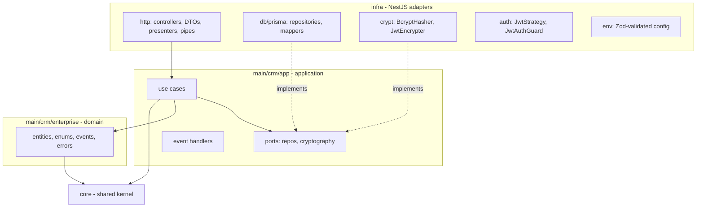
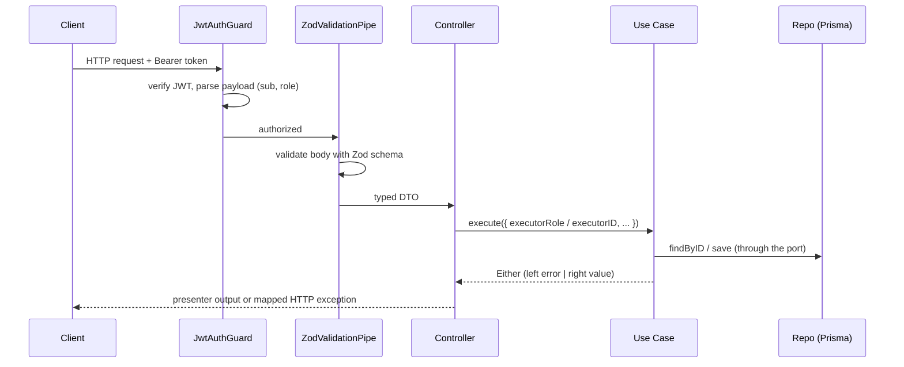

# Architecture

The project combines **Clean Architecture** and **Domain-Driven Design** on top of NestJS. Business rules are isolated from the framework, so NestJS, Prisma, JWT and bcrypt are replaceable details.

## Layers and the dependency rule

Dependencies always point **inward**.



| Layer          | Path                       | Depends on          | Responsibility                                          |
| -------------- | -------------------------- | ------------------- | ------------------------------------------------------- |
| Core           | `src/core`                 | nothing             | `Entity`, `AggregateRoot`, `ValueObject`, `WatchedList`, `Either`, `DomainEvents` |
| Domain         | `src/main/crm/enterprise`  | core                | Aggregates, invariants, domain events, entity errors    |
| Application    | `src/main/crm/app`         | domain, core        | Use cases, ports (abstract classes), event handlers     |
| Infrastructure | `src/infra`                | application, domain | HTTP, persistence, crypto, auth, configuration          |

Use cases carry the `@Injectable()` decorator so Nest can inject them, but they do not import any other framework code.

## Request lifecycle



1. **Guard** - `JwtAuthGuard` validates the token. `JwtStrategy` parses the payload with Zod (`sub` must be a UUID, `role` a string) and exposes it through the `@CurrentUser()` decorator.
2. **Pipe** - `ZodValidationPipe` validates request bodies and returns `400` with flattened Zod errors.
3. **Controller** - maps the DTO to the use case request, runs it and translates the result.
4. **Use case** - authorizes the executor, loads aggregates through ports, applies domain behavior, persists and dispatches domain events.
5. **Presenter** - shapes the HTTP output, so entities are never serialized directly (the password hash is never exposed).

## Error handling

Expected failures never throw. A use case returns `Either<L, R>`:

```ts
const result = await this.registerClient.execute({ ... });

if (result.isLeft()) {
  switch (result.value.constructor) {
    case ClientAlreadyExistsError:
      throw new ConflictException(result.value.message);
    default:
      throw new BadRequestException(result.value.message);
  }
}
const { client } = result.value;
```

Status mapping used by the controllers:

| Domain error                                  | HTTP status |
| --------------------------------------------- | ----------- |
| `NotAllowedError`                             | 403         |
| `SalespersonNotFoundError`                    | 404 (401 on `/auth`) |
| `SalespersonAlreadyExistsError`, `ClientAlreadyExistsError` | 409 |
| `WrongCredentialsError`                       | 401         |
| `SalespersonDeactiveError`                    | 409         |
| Validation failure (Zod)                      | 400         |

## Dependency injection

Ports are abstract classes, so they work as Nest injection tokens. Adapters are bound in modules:

```ts
{ provide: SalespersonsRepo, useClass: PrismaSalespersonsRepo }
{ provide: HashGenerator,    useClass: BcryptHasher }
{ provide: Encrypter,        useClass: JwtEncrypter }
```

| Module        | Provides                                                       |
| ------------- | -------------------------------------------------------------- |
| `AppModule`   | Root: `ConfigModule` (Zod validation), `HttpModule`, `DbModule`, `AuthModule`, `EnvModule` |
| `HttpModule`  | Controllers and use cases                                      |
| `DbModule`    | `PrismaService`, repository bindings                           |
| `CryptModule` | Hasher, comparer and encrypter bindings, `JwtModule` (1h tokens, HS256) |
| `AuthModule`  | `JwtStrategy`                                                  |
| `EnvModule`   | Typed `EnvService`                                             |

## Authentication and authorization

- `POST /auth` verifies the password with bcrypt, rejects inactive users and returns an HS256 JWT valid for **1 hour**, with claims `sub` (salesperson ID) and `role`.
- **Authorization lives in the use cases**, not in the controllers: each one checks the executor's role (or ID) and returns `NotAllowedError` when appropriate.

## Persistence

Prisma maps domain aggregates through dedicated **mappers** (`toDomain` / `toPrisma`), so the domain never sees Prisma types. Listing endpoints paginate with a fixed page size of **20**. See [domain-model.md](domain-model.md) for the schema.

## Adding a new endpoint

1. Add or reuse a use case in `src/main/crm/app/cases` (with `@Injectable()`), with its unit test.
2. Create a Zod schema/DTO in `infra/http/controllers/dtos`.
3. Create the controller (guard, pipe, error mapping, presenter) and register controller and use case in `HttpModule`.
4. Add an `*.e2e.ts` test next to the controller.
5. Document the route in [api.md](api.md).
