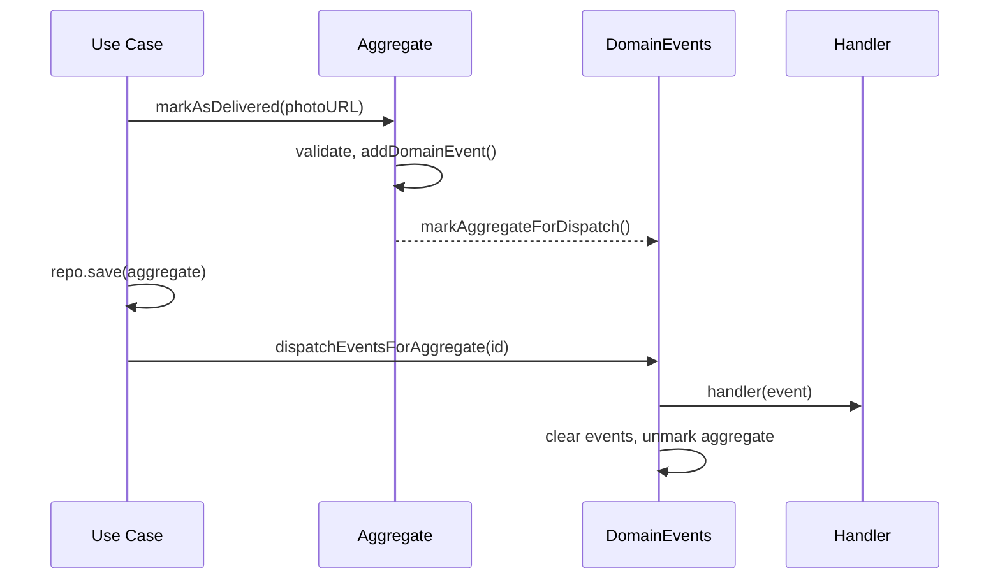

# Domain Events

Domain events state that something meaningful happened in the domain. They decouple what happened (the aggregate) from what to do about it (side effects such as notifying a manager).

## Building blocks

| Piece                     | Role                                                                      |
| ------------------------- | ------------------------------------------------------------------------- |
| `DomainEvent`             | Interface: `ocurredAt: Date` and `getAggregateID()`                        |
| `AggregateRoot`           | Holds queued events; `addDomainEvent()` also marks the aggregate for dispatch |
| `DomainEvents`            | Static bus: `register(callback, eventName)` and `dispatchEventsForAggregate(id)` |
| `EventHandler`            | Interface with `setupSubscriptions()`; handlers subscribe in their constructor |

## Event catalog

| Event                                | Raised when                                  | Handler                              |
| ------------------------------------ | -------------------------------------------- | ------------------------------------ |
| `SalesPersonEvent`                   | A salesperson is created                     | -                                    |
| `ClientCreatedEvent`                 | A client is created                          | -                                    |
| `SalesOpportunityCreatedEvent`       | A sales opportunity is created               | `OnSalesOpportunityCreated`          |
| `SalesOpportunityHighValueEvent`     | `updateValue()` sets a new value >= 10,000   | `OnHighValueSalesOpportunityUpdated` |
| `SalesOpportunityStatusUpdatedEvent` | `updateStatus()` changes the status          | `OnSalesOpportunityStatusUpdated`    |
| `SalesOpportunityLostEvent`          | `markAsLost()` succeeds                      | `OnLostSalesOpportunityUpdated`      |
| `SalesOpportunityDeliveredEvent`     | `markAsDelivered()` succeeds                 | `OnDeliveredSalesOpportunityUpdated` |

Current handlers only log an alert to the console; they are the extension point for e-mail, push or queue-based notifications.

## Dispatch flow (store, then dispatch)

Mutating an aggregate only queues the event. The use case dispatches it **after** persisting, so handlers never react to unsaved data.

Bus behavior:

- An aggregate is marked once, even with several queued events.
- `DomainEvents.shouldRun = false` disables dispatching.
- `clearHandlers()` and `clearMarkedAggregates()` reset state between tests.
- Dispatch is keyed by `event.constructor.name`, which can break if class names are mangled by minification.

## Current wiring status

Handlers are exercised by the unit tests (they are instantiated in the sales opportunity use case tests), but **they are not yet registered in the Nest application** and sales opportunities have no HTTP endpoints or persistence yet. To activate them, provide the handler classes in a Nest module so they are instantiated at boot.

## Adding a new event

1. Create the event class in `enterprise/events`, implementing `DomainEvent`.
2. Raise it in the aggregate with `this.addDomainEvent(new MyEvent(this))`.
3. Create a handler in `app/handlers` and subscribe with `DomainEvents.register(cb, MyEvent.name)`.
4. Make sure the use case calls `DomainEvents.dispatchEventsForAggregate(aggregate.id)` after persisting.
5. Cover it in the use case tests.
