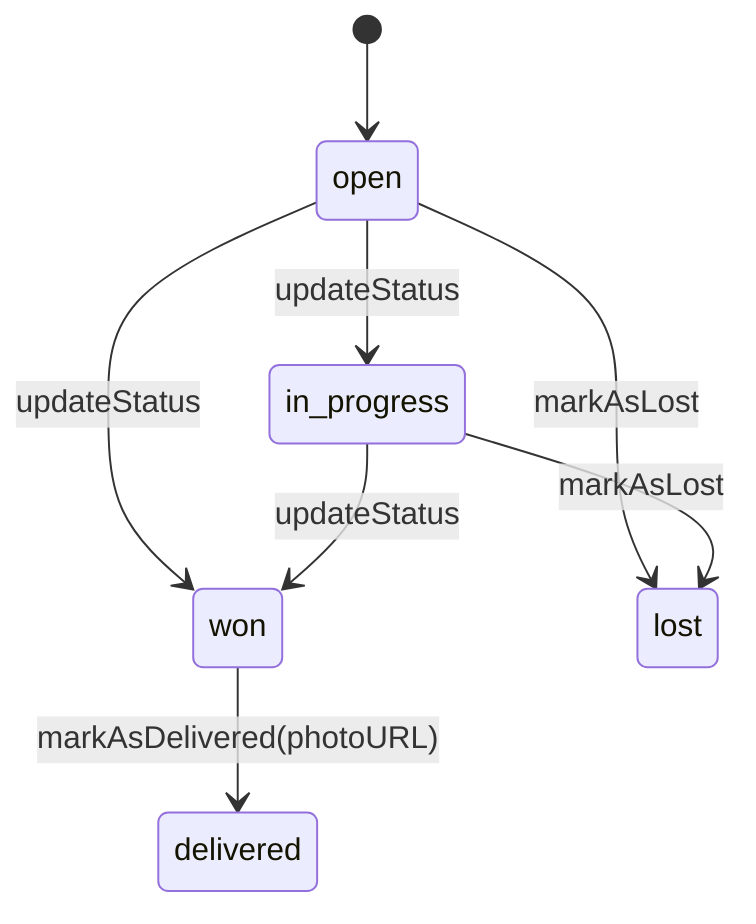
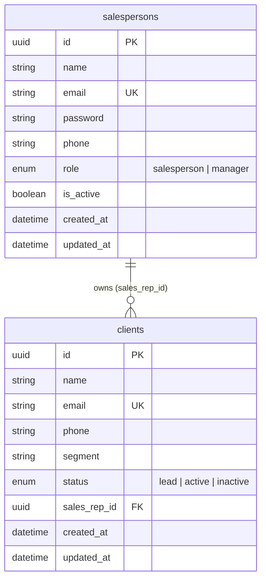

# Domain Model

## Aggregates

All aggregates extend `AggregateRoot` and are created through `static create(props, id?)`, which applies defaults and raises a *created* event only when no `id` is given (a new aggregate, not one rehydrated from the database).

### Salesperson

| Property       | Notes                             |
| -------------- | --------------------------------- |
| `name`, `phone`|                                   |
| `email`        | Unique                            |
| `passwordHash` | bcrypt hash, never plain text     |
| `role`         | `salesperson` (default), `manager` |
| `isActive`     | Default `true`; `false` blocks login |

### Client

| Property     | Notes                                                |
| ------------ | ---------------------------------------------------- |
| `creatorID`  | Defaults to `salesRepID`                             |
| `salesRepID` | Current responsible salesperson                      |
| `status`     | `lead` (default), `active`, `inactive`               |
| `name`, `email`, `phone`, `segment` |                       |

### Sales Opportunity

| Property           | Notes                                           |
| ------------------ | ----------------------------------------------- |
| `creatorID`, `clientID`, `salesRepID` | References to the creator, client and owner |
| `title`, `description`, `value` | `value >= 10000` raises the high-value event |
| `status`           | `open` (default), `in_progress`, `won`, `lost`, `delivered` |
| `deliveryPhotoURL` | Required to mark as delivered                   |

### Opportunity life cycle

`markAsLost()` fails with `CantMarkSalesOpportunityAsLostError` outside `open`/`in_progress`. `markAsDelivered()` fails with `SalesOpportunityWrongStatusError` unless the status is `won`, and with `SalesOpportunityPhotoURLRequiredError` without a photo.

## Database schema

Defined in `prisma/schema.prisma` (PostgreSQL). Currently persisted: salespersons and clients. Sales opportunities have no table yet.

Notes:

- Mappers in `src/infra/db/prisma/mappers` translate between Prisma rows and aggregates.
- The domain `Client.creatorID` is not persisted yet.

### Known issues (not yet fixed)

- **`isActive` is not rehydrated**: `PrismaSalespersonMappers.toDomain` does not pass `isActive`, so the aggregate defaults to `true` when loaded. Verify that inactivated salespersons are really blocked from authenticating.
- **JWT secret fallback**: `CryptModule` signs tokens with `process.env.JWT_SECRET || 'default-secret'`, while `JwtStrategy` verifies with the validated `JWT_SECRET`. Always set `JWT_SECRET` (the app validates it at boot).

### Migration history

| Migration | Change |
| --------- | ------ |
| `20251117222222_create_salesperson_client_models` | Creates `salespersons`, `clients` and the enums |
| `20251105120000_rename_saleperson_role` | Renames the `SalespersonRole` value `saleperson` to `salesperson`, so the Prisma and domain enums match |

## Errors

| Level          | Location                         | Examples                                                   |
| -------------- | -------------------------------- | ---------------------------------------------------------- |
| Entity         | `enterprise/entities/errors`     | `CantMarkSalesOpportunityAsLostError`, `SalesOpportunityPhotoURLRequiredError` |
| Use case       | `app/cases/errors`               | `SalespersonAlreadyExistsError`, `ClientNotFoundError`     |
| Shared kernel  | `core/errors/errors`             | `NotAllowedError`, `ResourceNotFoundError`, `WrongCredentialsError` |
